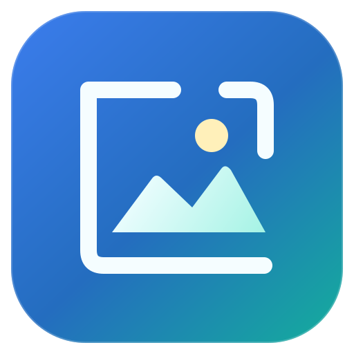
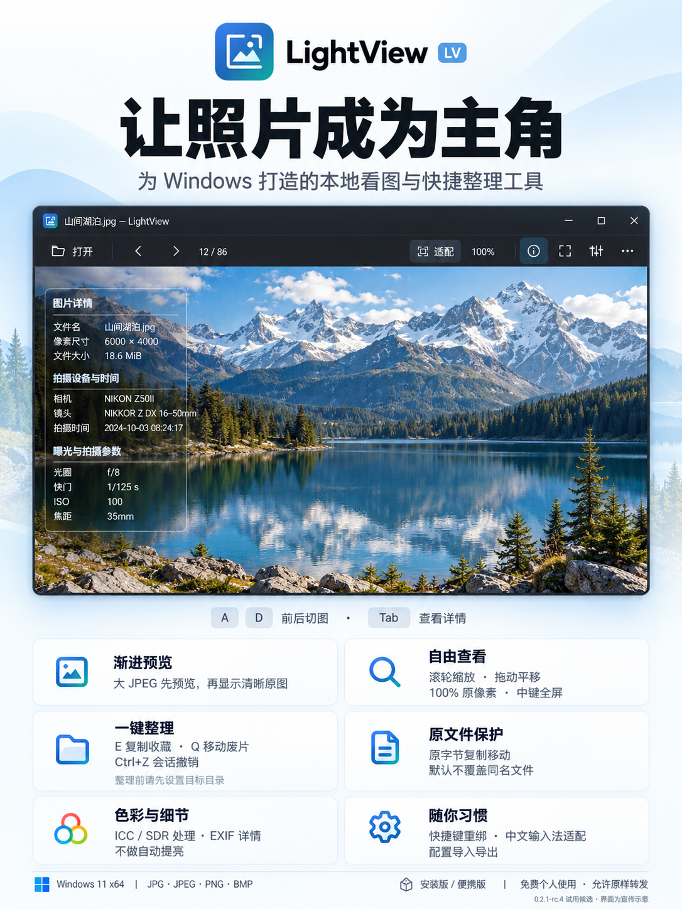

# LightView · 让照片成为主角

为 Windows 打造的本地看图与快捷整理工具。免费个人使用，允许原样转发完整安装包或便携 ZIP。

**当前版本：0.2.1-rc.4 试用候选。** 本仓库仅提供下载、使用说明与反馈入口，不包含 LightView 应用源码。

**[下载安装版](https://github.com/WuQiong2006/LightView/releases/download/v0.2.1-rc.4/LightView-0.2.1-rc.4-win-x64-setup.exe)** · **[下载便携版](https://github.com/WuQiong2006/LightView/releases/download/v0.2.1-rc.4/LightView-0.2.1-rc.4-win-x64-portable.zip)** · [查看版本与说明](https://github.com/WuQiong2006/LightView/releases/tag/v0.2.1-rc.4)

## 功能与特色

| 功能 | 说明 |
|---|---|
| 渐进预览 | 大 JPEG 先显示预览，再替换为清晰原图 |
| 自由查看 | 滚轮缩放、拖动平移、100% 原像素与中键全屏 |
| 快捷整理 | E 复制到收藏预设，Q 移动到废片预设，Ctrl+Z 撤销本会话最近成功操作 |
| 原文件保护 | 复制/移动保留原字节，默认不覆盖同名文件；长按Q不会连续移动其他图片 |
| 色彩与详情 | ICC/SDR处理、EXIF详情，不做自动提亮；不承诺未经实测的显示器色彩准确性 |
| 个人习惯 | 快捷键重绑、中文输入法适配、配置导入导出 |
| 本地使用 | 无需账号，无遥测；安装版与独立数据便携版任选 |

## 安装与开始使用

支持声明：**Windows 11 x64，JPG / JPEG / PNG / BMP**。两个版本均为自包含版本，无需另装 .NET。

- **安装版**：下载 `setup.exe`，正常退出旧版后运行。首次可选安装目录，升级沿用原位置；安装后从开始菜单启动。
- **便携版**：下载文件名带 `portable` 的 ZIP，完整解压到可写目录后运行 `LightView.exe`。设置和日志默认保存在旁边 `UserData`。
- **预设目录**：默认留空，使用E/Q整理前请先在设置中配置目标目录。
- **默认应用**：安装版在“设置→默认应用”打开Windows设置，由用户自行选择。便携版不注册默认应用。

默认快捷键：F打开、A/D前后切图、中键全屏、Home设置、Tab详情、E复制收藏、Q移动废片、Ctrl+Z会话撤销。快捷键和预设可重新绑定。

## 试用范围

当前候选未签名；已完成本机工程检查，干净机器、跨电脑和完整默认应用打开矩阵仍待验证。请保留试用状态说明，不将本候选作为已经完成公开稳定版验收的版本传播，也不要绕过Windows安全拦截。

下载附件中的“使用说明”“试用验证说明”了解范围，并使用 `SHA256SUMS.txt` 核对文件完整性。GitHub自动生成的 `Source code` 压缩文件是本下载仓库的文件，不是可运行的LV便携包。

## 许可与反馈

LightView 自有部分遵循本仓库 [个人免费使用许可](LICENSE.txt)：允许个人非商业使用和原样转发完整发行包；其他用途需取得作者许可。第三方组件的权利仍按各自许可证执行，完整声明随安装包/便携包提供。

反馈时请提供Windows版本、LightView版本、安装版或便携版及复现步骤。优先使用人工图片复现，无需提供私人照片、个人目录或完整日志。
